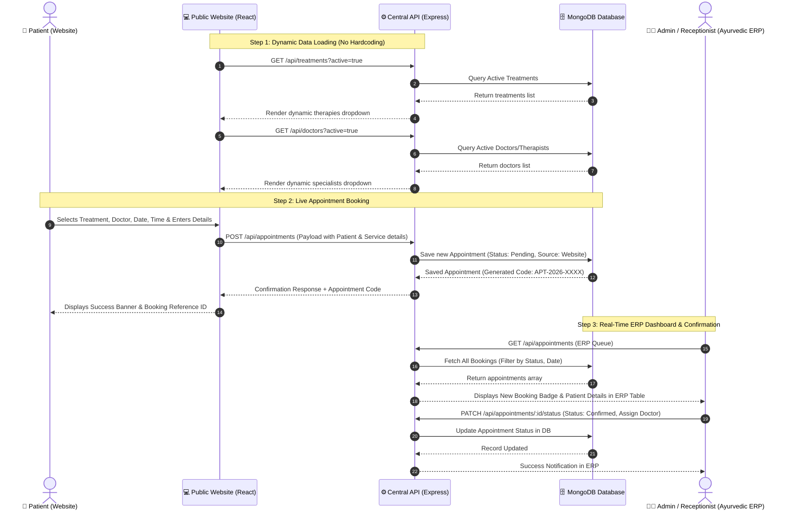
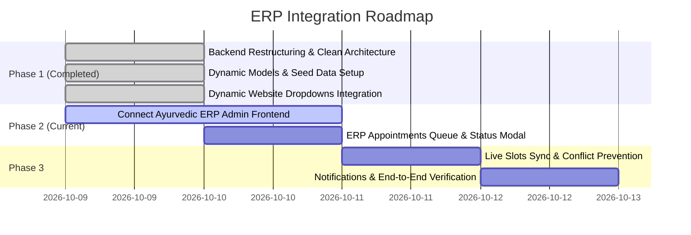

# 🏥 Ortho Neuro Care & Ayurvedic ERP - Complete Integration Blueprint

This document details the clean architecture, standardized REST APIs, shared data schemas, and end-to-end integration strategy to connect the **Public Website** and the **Ayurvedic ERP Admin Panel** with **zero hardcoded data**.

---

## 📁 1. Standardized Project Directory Structure

```
ortho-neuro-care/
├── backend/                              # Express & Node.js REST API Server
│   ├── src/
│   │   ├── config/
│   │   │   └── db.js                    # Resilient MongoDB database connection
│   │   ├── controllers/                 # Business logic & request handlers
│   │   │   ├── appointmentController.js # Booking, listing, status updates (ERP Sync)
│   │   │   ├── doctorController.js      # Dynamic doctors & therapists management
│   │   │   ├── treatmentController.js   # Dynamic treatments & therapies catalog
│   │   │   ├── slotController.js        # Live availability slot calculation
│   │   │   ├── contactController.js     # Contact inquiries
│   │   │   └── newsletterController.js  # Newsletter subscription
│   │   ├── data/
│   │   │   └── seedData.js              # Initial therapies & doctor seed dataset
│   │   ├── middlewares/
│   │   │   └── errorHandler.js          # 404 and global error handlers
│   │   ├── models/                      # Mongoose data models
│   │   │   ├── Appointment.js           # Shared appointment & tracking model
│   │   │   ├── Doctor.js                # Specialist profile & schedules
│   │   │   ├── Treatment.js             # Treatments catalog
│   │   │   ├── Contact.js               # Enquiries model
│   │   │   └── Newsletter.js            # Subscriptions model
│   │   ├── routes/                      # Modular API routes
│   │   │   ├── appointmentRoutes.js     # /api/appointments
│   │   │   ├── doctorRoutes.js          # /api/doctors
│   │   │   ├── treatmentRoutes.js       # /api/treatments
│   │   │   ├── slotRoutes.js            # /api/slots
│   │   │   ├── contactRoutes.js         # /api/contact
│   │   │   └── newsletterRoutes.js      # /api/newsletter
│   │   ├── app.js                       # Express app configuration & middleware
│   │   └── server.js                    # Server bootstrap entry point
│   ├── .env                             # Environment configuration (Port, DB URI)
│   ├── .env.example                     # Environment template
│   ├── package.json                     # Dependencies & scripts
│   └── README.md                        # Backend documentation
│
├── frontend/                             # Public Client Facing Web Application (Vite + React)
│   ├── src/
│   │   ├── assets/                      # Icons, static images, logos
│   │   ├── components/                  # React UI components
│   │   │   ├── Booking.jsx              # Dynamic appointment booking engine
│   │   │   ├── Treatments.jsx           # Dynamic treatment showcase
│   │   │   ├── Navbar.jsx               # Navigation bar
│   │   │   ├── Footer.jsx               # Footer with newsletter hook
│   │   │   └── ...
│   │   ├── pages/                       # Home, About, Booking, Treatments pages
│   │   ├── services/
│   │   │   └── api.js                   # Unified API client functions
│   │   ├── App.jsx                      # Routing & layout
│   │   └── main.jsx                     # Vite entry point
│   ├── .env                             # VITE_API_URL=http://localhost:5000/api
│   ├── vite.config.js                   # Dev server & /api proxy
│   └── package.json
│
└── ERP_INTEGRATION_PLAN.md              # Complete Integration Blueprint
```

---

## 🔄 2. End-to-End System Architecture



---

## 🗃️ 3. Centralized Database Schemas

### 1. Appointments (`models/Appointment.js`)
| Field | Type | Description |
|---|---|---|
| `appointmentCode` | `String` (Unique) | Auto-generated code (e.g. `APT-2026-4892`) |
| `patient.name` | `String` (Required) | Full name of patient |
| `patient.phone` | `String` (Required) | Contact phone number |
| `patient.email` | `String` (Required) | Patient email |
| `treatmentId` | `ObjectId` (Ref: Treatment) | Dynamic reference to treatment |
| `treatmentName` | `String` (Required) | Treatment title |
| `doctorId` | `ObjectId` (Ref: Doctor) | Dynamic reference to doctor/therapist |
| `doctorName` | `String` | Specialist name |
| `date` | `String` (Required) | Date format `YYYY-MM-DD` |
| `timeSlot` | `String` (Required) | Selected slot (e.g. `10:00 AM`) |
| `status` | `Enum` | `Pending`, `Confirmed`, `In-Progress`, `Completed`, `Cancelled`, `Rescheduled` |
| `source` | `Enum` | `Website`, `ERP Admin`, `Walk-in`, `Phone` |
| `erpSyncStatus` | `Enum` | `Synced`, `Pending` |

### 2. Treatments (`models/Treatment.js`)
| Field | Type | Description |
|---|---|---|
| `title` | `String` (Required) | Therapy name (e.g. `Shirodhara`) |
| `slug` | `String` | URL-safe slug |
| `category` | `Enum` | `Ayurveda`, `Neurology`, `Orthopedics`, `Wellness` |
| `durationMinutes` | `Number` | Duration (e.g. `45`, `60`) |
| `price` | `Number` | Treatment cost in INR |
| `benefits` | `[String]` | List of health benefits |
| `isActive` | `Boolean` | Visibility switch (Website & ERP) |

### 3. Doctors & Therapists (`models/Doctor.js`)
| Field | Type | Description |
|---|---|---|
| `name` | `String` (Required) | Doctor / Specialist Name |
| `role` | `Enum` | `Ayurvedic Specialist`, `Physiotherapist`, `Senior Therapist`, `Doctor` |
| `specialization` | `String` | Medical expertise |
| `gender` | `Enum` | `Male`, `Female`, `Any` |
| `availableDays` | `[String]` | Working days (`Monday` - `Sunday`) |
| `workingHours` | `{ start, end }` | Daily hours (`09:00` - `19:00`) |
| `isActive` | `Boolean` | Active status |

---

## 📡 4. Master REST API Specification

### A. Public Website Endpoints
- `GET /api/treatments?active=true` - Fetch active treatments for dropdowns & pages.
- `GET /api/doctors?active=true` - Fetch active doctors & therapists.
- `GET /api/slots?date=YYYY-MM-DD&doctorId=...` - Fetch available time slots.
- `POST /api/appointments` - Book online appointment.
- `POST /api/contact` - Submit contact message.
- `POST /api/newsletter` - Subscribe to newsletter.

### B. Ayurvedic ERP Admin Panel Endpoints
- `GET /api/appointments?status=&date=&search=` - List all appointments with filtering & search.
- `PATCH /api/appointments/:id/status` - Update appointment status (`Confirmed`, `Completed`, `Cancelled`, etc.) and reassign doctors.
- `POST /api/treatments` - Add a new therapy from ERP Admin.
- `POST /api/doctors` - Add/Update doctor profiles and schedules.

---

## ⚙️ 5. Step-by-Step Execution Plan



### **Phase 1: Backend Restructure & Dynamic Website Dropdowns (✅ COMPLETED)**
1. Structured backend cleanly inside `backend/src/` with modular controllers, routes, and models.
2. Built dynamic Treatment, Doctor, Slot, and Appointment endpoints.
3. Updated `frontend/src/components/Booking.jsx` to load treatments and therapists dynamically from the API.

### **Phase 2: Ayurvedic ERP Admin Panel Linkage (NEXT STEP)**
1. In the Ayurvedic ERP Frontend, configure the API base URL to `http://localhost:5000/api`.
2. Hook up ERP Appointments screen to `GET /api/appointments`.
3. Add one-click action buttons in ERP to trigger `PATCH /api/appointments/:id/status` (`Confirm`, `Reschedule`, `Complete`, `Cancel`).
4. Display a dedicated badge for appointments originating from the **Website** (`source: 'Website'`).

### **Phase 3: Real-Time Sync & Final Testing**
1. Ensure slot availability reflects both website and ERP walk-in bookings.
2. Test full lifecycle: Website Booking $\rightarrow$ ERP Admin Live View $\rightarrow$ Status Update $\rightarrow$ Confirmation.
